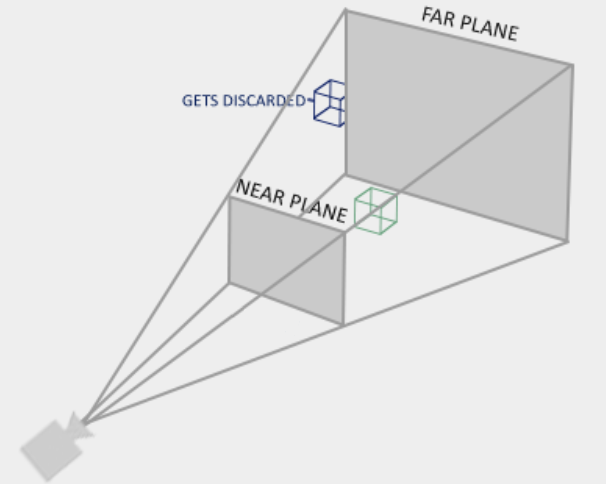
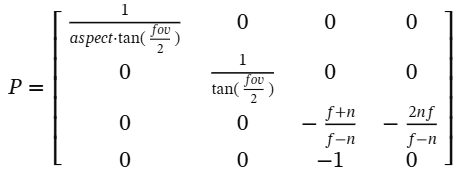

#
<style>code{color:green;font-weight: bold;}nav a{color:green!important}</style>
<nav style="position:fixed;left:0;bottom:0;">
[返回](#top)/ [返回](#top)</nav>

`▼`请勿使用learnopengl的资料。  

## 纹理
光栅图元的纹理通常使用顶点纹理坐标属性进行插值。  
OpenGL允许我们使用单位坐标之外的"环绕"处理，以及在该插值浮点纹理坐标采样的过滤方法，直接取最近像素或临近插值。  
```cpp
glTexParameteri(GL_TEXTURE_2D, GL_TEXTURE_WRAP_S / GL_TEXTURE_WRAP_T, ENUM);
GL_REPEAT GL_MIRRORED_REPEAT GL_CLAMP_TO_EDGE GL_CLAMP_TO_BORDER

glTexParameteri(GL_TEXTURE_2D, GL_TEXTURE_MIN_FILTER / GL_TEXTURE_MAG_FILTER, ENUM);
GL_NEAREST GL_LINEAR
```
尽管纹理插值方法看似很简单(无需复杂的映射机制)，但远处仍然存在纹理的过滤问题。OpenGL可以生成纹理缩放版本(Mipmaps)，并在远处采样非常小的纹理图像，因此可以避免问题。  

```cpp
void glGenTextures(n, *id);
void glActiveTexture(GL_TEXTURE0+15);
void glBindTexture(GL_TEXTURE_2D, texture);

void glTexImage2D(GL_TEXTURE_2D, level, GL_RGB, w, h, border=0, format(GL_RGB), type(GL_UNSIGNED_BYTE), data)
                         // Mipmap基本级别 内存储纹理格式            源像素格式、源数据类型、源数据

void glGenerateMipmap(GL_TEXTURE_2D);
```
纹理单元位置有16个，在着色器中通过设置uniform sampler的整数值来索引已传输的纹理。  

## 正确理解光栅中的变换
要继续这一节，先理解其完全遵循光栅的核心视口配置原理，然后不要对着投影矩阵练死劲。  

前一个矩阵是让整个世界走向相机，视点位于图例的原点，同样对准Z轴，**观察完全相同**。  

视口作为视锥体的所谓的近平面，通常会给定其他平面的"裁剪"限制进行限制参数化视锥体，该过程会被投影矩阵描述，并且插入四维坐标为变换之后的Z除作准备。之后OpenGL自动对该顶点阶段的输出gl_Position进行Z除、裁剪，所有顶点进入(-1..1)的归一立方体中。注意变换尚不执行Z除，其定义裁剪面参数和塞入深度到四维坐标。  

`▼`如果顶点本身就位于近平面上，那么其NDC深度结果为-1。在远平面上，就是1。任何NDC的xy坐标就是单位视口(因为近平面被归一)上应该出现该顶点的位置。所谓的裁剪就是过滤掉NDC绝对值大于1的值。  
`▼`如果需要更干净的理解。就是图例中的状态。  
`▼`openGL的设计是顶点输出的空间位于NDC中，投影自行进行处理。  

```ruby
p = Mproj * Mview * Mobj * v  ==> opengl ==> NDC

glm::ortho(0.0f, 800.0f, 0.0f, 600.0f, 0.1f, 100.0f);
# 左右，上下，近远
glm::perspective(glm::radians(45.0f), aspect, 0.1f, 100.0f);
```
`▼`透视矩阵使用远近，fov和视口比例参数表达所有面。  
<div class="x gr txac">
  <div class="x la flex mg0">
    <div class="x la item3-lg item6 pd0 sk bgw">
      
    </div>
        <div class="x la item6-lg item6 pd0">
      
    </div>
  </div>
  <p></p>
</div>

参考OpenGL投影矩阵来获得更详细的描述。视坐标为(xyz1)。  
设计矩阵时，回顾一下缩放公式。先将Z除和原始值xy丢到齐次处理以及输入向量中，因此只剩下一个n。NDC归一必须使其y除以视口半高hy来匹配视口形状，这可以从fov得到。  
OpenGL的近平面设计朝向-Z轴，而n,f参数为正。  
第四行表示将-z(>0)完全复制到w坐标中。因此正确地缩放XY坐标，而不是相反。  
```ruby
y = zy' / z' = ny'/z'

n/hy = 1/ tanθ

w = -z'
```
第三行对z的处理主要是为了整理出一个表达式，使其被Z除时不直接变为1，而是仍然能表达其在两个平面之间的NDC深度关系，用于我们的NDC目的。即使其在-n等于-1，-f等于1。  
首先设计了一个形式：  
```ruby
z = a33z' + 1 * a34
#如果除以-z
    -A - B/z'
# 根据条件：
-A + B/n = -1 && -A + B/f = 1

=> A = - [(f+n)/(f-n)]
   B = - [2nf/(f-n)]
   # gotcha?
```
最后，Z除执行，w被归为1。  
`▼`这是一个矩阵完全用于行点积计算的例子。  
`▼`很难说为什么一开始可以设计成Az+B的形式，留给读者思考。NDC中的保留深度是非线性的，原始深度是线性的。  

## 模型
为了使用艺术资产，需要将模型数据解耦为几个有用的数据结构。  
顶点(包含位置、法线等)、Mesh是一小组图元，包含顶点、索引，纹理(使用相同点)，VAO，实例化时应该完成VAO，绘制时应该激活纹理并调用绘制函数。  

模型处理资产输入并存入我们解析mesh列表，绘制时对每个mesh调用绘制。加载使用第三方库读取模型文件，解析成我们的mesh格式。  

## 深度测试
片阶段结束后，OpenGL使用Z-buffer处理片的遮挡，如果测试通过则保留片段并更新缓冲器为最近深度值。  

gl_FragCoord可访问片元的一些信息。xy代表当前像素在窗口中的具体位置，z为该片像素的深度值((NDC.z + 1) * 0.5)。w为透视除数(并非保留1)。  

```cpp
glEnable(GL_DEPTH_TEST);
```

`▼`OpenGL的投影矩阵的Z坐标处理产出的NDC深度对于原空间并不是线性的。大多数深度精度都堆在了近处。要还原这种特征(线性并在最远处才达到1)，通常需要程序员自行处理。  
`▼`现代渲染中，每一帧都实际上重绘整个场景，因此该算法每次都重新运行。因此，在帧渲染前将其清除为无限远是一种默认约定。  

下面给出了一个还原例子，指出了相机垂直轴的距离。  
`▼`从投影矩阵中找出Z关系即可。参考OpenGL投影矩阵来获得更详细的描述。    
```cpp
near -----> far
-1          1

float linearize_depth(float depth, float n, float f) {
  float ndcz = depth * 2.0 - 1.0;
  return (2.0 * n * f) / (f + n - ndcz * (f - n));
}
```

## 模板测试
词源为漏花纸板（Stencil）。  

该阶段位于深度测试之前。首先开启该测试功能。  
```cpp
glEnable(GL_STENCIL_TEST);

void glStencilFunc(func, ref, mask);
       // 设定参考值与缓冲器比较的逻辑函数  数据位掩码(两者都先进行掩码)
GL_EQUAL GL_NOTEQUAL GL_LESS GL_GREATER  / GL_ALWAYS GL_NEVER

// 设置不同测试结果分支行为
void glStencilOp(sfail, dpfail, dppass);
             // 测试失败  之后的深度测试失败 全部通过
GL_KEEP GL_ZERO GL_REPLACE  // 不改变，设为0，替换ref值
GL_INCR GL_INCR_WRAP GL_DECR GL_DECR_WRAP GL_INVERT

void glStencilMask( 0xFF / 0x00 ); // 不用管后面的两个十六进制，要写入就填ff
```

## discard
丢弃片段。  
```cpp
if (col.a < 0.1) discard;
```

## 混合
OpenGL在最后阶段进行混合。计算操作片段颜色和颜色缓冲器颜色的混合方程。这可以实现许多我们说明的"合并"的特殊效果。  
```cpp
glEnable(GL_BLEND);

C = frag * f1 op buffer * f2;

void glBlendFunc(f1, f2);   // 决定两个因子使用什么数据
GL_ZERO GL_ONE
GL_SRC_COLOR GL_DST_COLOR
GL_SRC_ALPHA GL_ONE_MINUS_SRC_ALPHA GL_DST_ALPHA GL_ONE_MINUS_DST_ALPHA
GL_CONSTANT_COLOR GL_CONSTANT_ALPHA

void glBlendEquation(op);
GL_FUNC_ADD GL_FUNC_SUBTRACT GL_FUNC_REVERSE_SUBTRACT GL_MIN GL_MAX

void glBlendFuncSeparate(rgbf1, rgbf2, af1, af2);
// 允许开发者为RGB颜色通道和Alpha透明通道分别设置不同的混合因子
```

## 帧缓冲器
FBO是一种openGL容器对象。  
绘制函数(或大多数渲染操作)在当前活动的帧缓冲器附加的几个缓冲器中进行操作。窗口系统自动创建0号FBO并将其绑定。  
```cpp
void glGenFramebuffers(n, *id);
void glBindFramebuffer(GL_FRAMEBUFFER / GL_READ_FRAMEBUFFER / GL_DRAW_FRAMEBUFFER, fbo);
// 绑定活动帧缓冲器状态。一般只绑定和使用一种。
void glDeleteFramebuffers(n, fbo);

// 检查完整性准备状态
glCheckFramebufferStatus(fbo) == GL_FRAMEBUFFER_COMPLETE    
```

将纹理对象"附加"(引用)给FBO。可见有颜色、深度和模板等。  
如果要创建对应的特殊颜色、深度纹理，则需要glTexImage2D设置为相应类型。  
```cpp
void glFramebufferTexture2D(target, attachment_type, GL_TEXTURE_2D, textureID, mipmapLevel);
// 目标，见绑定状态
// 附加纹理类型 
GL_COLOR_ATTACHMENTi 
GL_DEPTH_ATTACHMENT GL_STENCIL_ATTACHMENT GL_DEPTH_STENCIL_ATTACHMENT
```
FBO机制允许我们将渲染结果作为一般纹理来使用，并添加多个渲染目标。  